<!-- ============ HEADER ============ -->

  

  
  
  

---

  <picture>
    <source media="(prefers-color-scheme: dark)" srcset="./card-dark.svg">
    
  </picture>

---

## 🛠️ Tech Stack

   
  

  
  
  
  
  
  

---

## 🚀 Featured Projects

<table>
<tr>
<td width="50%" valign="top">

### 🛡️ [PERISAI-RESPON](https://github.com/poggymacello/perisai-respon)
**Offline** cyber-incident triage assistant that can't be steered by injected log content. Injection success rate dropped **16.5% → 0%**.

[🌐 Live demo](https://perisai-respon.vercel.app) · [📦 Release](https://github.com/poggymacello/perisai-respon/releases)

</td>
<td width="50%" valign="top">

### 💰 [Kendali](https://github.com/poggymacello/kendali)
Policy-bounded **AI treasury agent**. *The LLM proposes, the policy decides, the contract enforces.*

</td>
</tr>
<tr>
<td width="50%" valign="top">

### ☸️ [nf-orchestrator](https://github.com/poggymacello/nf-orchestrator)
Intent-based **network function orchestration** on Kubernetes, a clean-room re-implementation.

</td>
<td width="50%" valign="top">

### ♻️ [EcoLoop](https://github.com/poggymacello/ecoloop)
Digital ecosystem platform for **e-waste in Indonesia**.

</td>
</tr>
</table>

### 🔬 ML × Cybersecurity Lab
Six projects, all on **real public datasets** with leakage-safe evaluation and a **FastAPI + Docker** inference service that is actually built and run.

| | Project | What it does | Data |
|:-:|---|---|---|
| 🌐 | [**shadowtrace**](https://github.com/poggymacello/shadowtrace) | Network traffic anomaly detection (HMM vs Isolation Forest) | UNSW-NB15 |
| 🎣 | [**phishnet-ai**](https://github.com/poggymacello/phishnet-ai) | Phishing URL detection (attention NN vs gradient boosting) | PhiUSIIL |
| ⚡ | [**electroshield**](https://github.com/poggymacello/electroshield) | Electricity theft detection on the smart grid | SGCC |
| 🦠 | [**malwaremorph**](https://github.com/poggymacello/malwaremorph) | Malware detection from static PE features | BODMAS / EMBER |
| 📡 | [**iotlock**](https://github.com/poggymacello/iotlock) | IoT network resilience + botnet detection | Topology Zoo + N-BaIoT |
| 🔐 | [**cryptosentry**](https://github.com/poggymacello/cryptosentry) | RSA internals, key-risk assessment & post-quantum readiness | Certificate Transparency |

---

## 🏆 Competitions & Hackathons 2026

  
  
  
  
  
  
  
  

---

## 📊 GitHub Activity

  

  

<!-- Contribution snake: appears after .github/workflows/snake.yml runs once -->

  <picture>
    <source media="(prefers-color-scheme: dark)" srcset="https://raw.githubusercontent.com/poggymacello/poggymacello/output/github-contribution-grid-snake-dark.svg" />
    
  </picture>

---

## 🤝 Let's Connect

  
  
  

